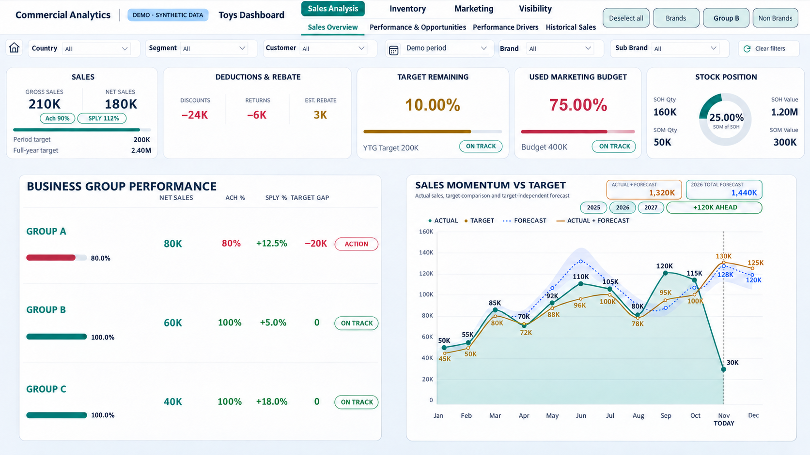
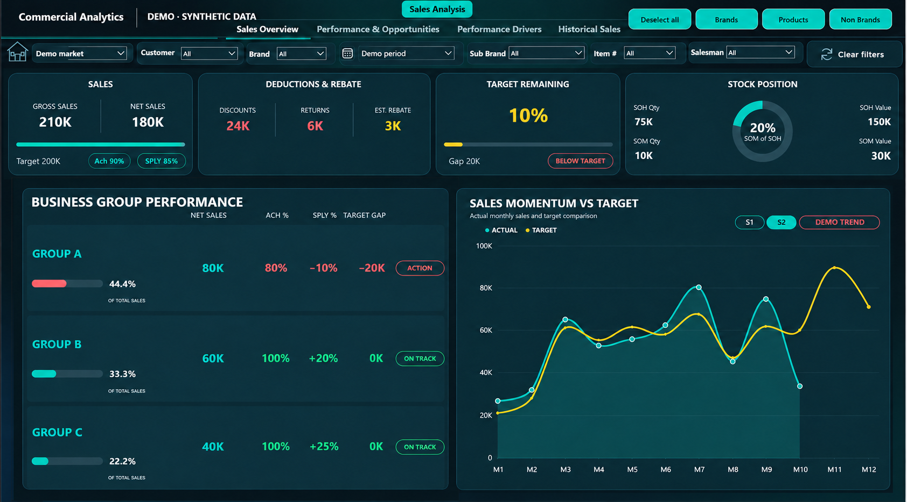
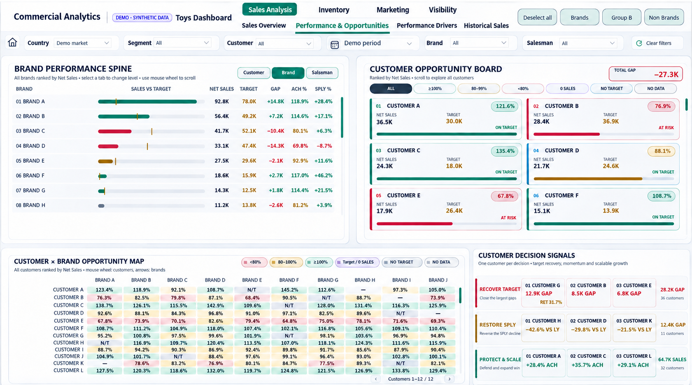
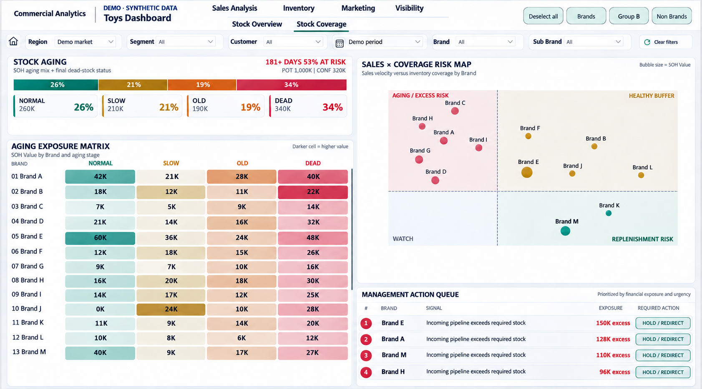
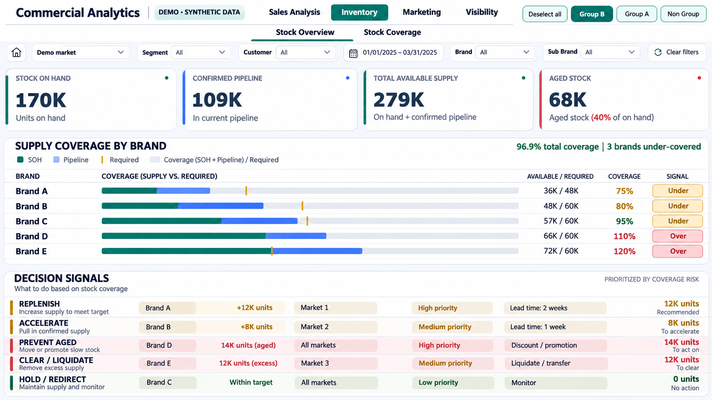
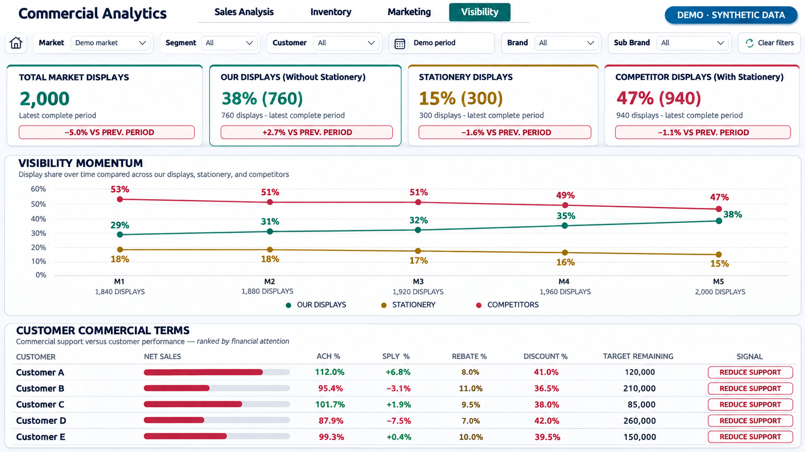
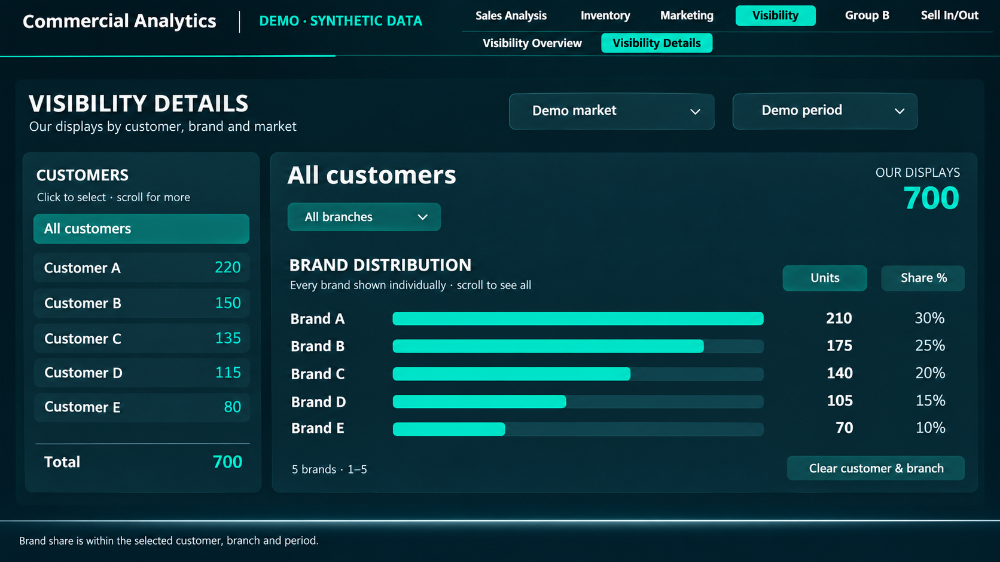
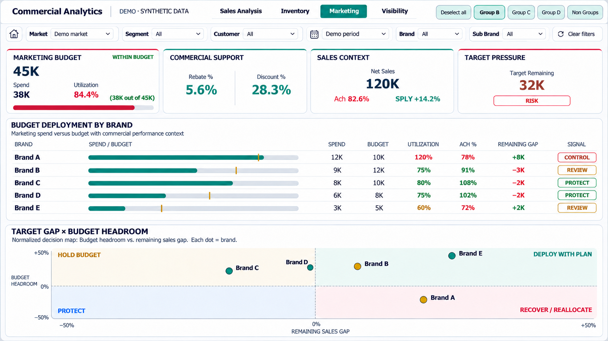
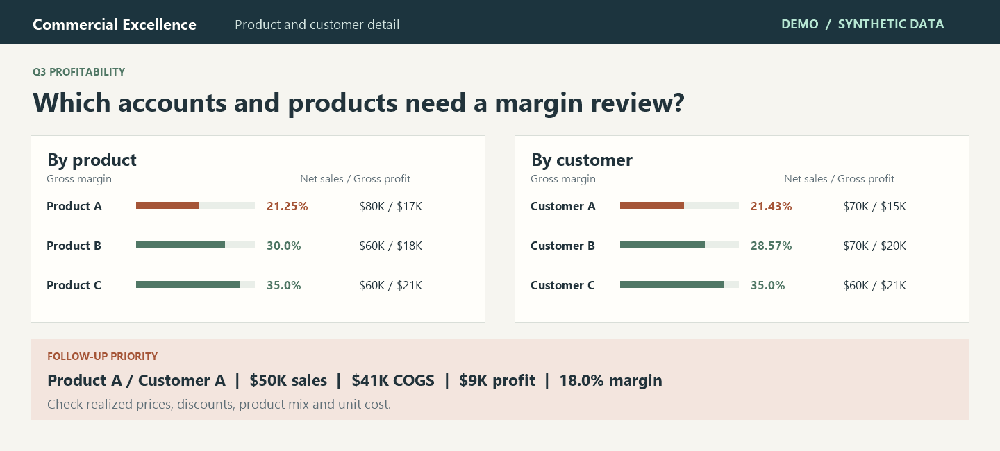
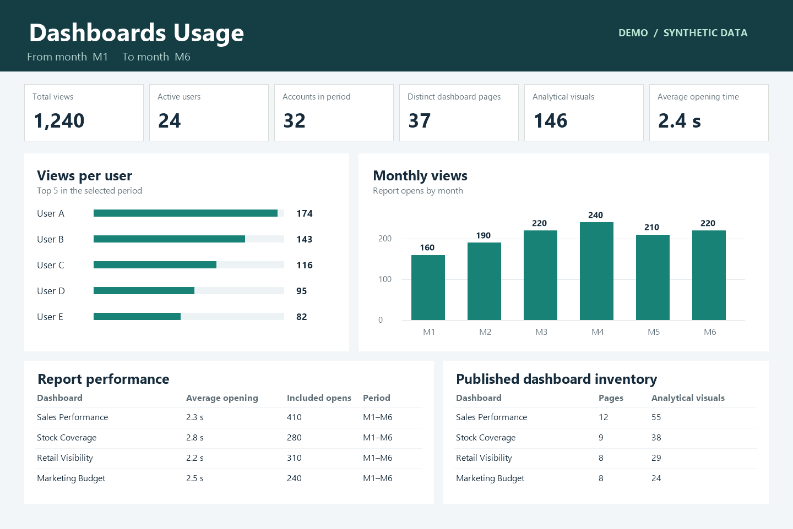

# Commercial BI Portfolio

**Mohammad Sabri Ali · Business Intelligence Analyst**

> **DEMO · SYNTHETIC DATA** — All figures, data labels, and example findings shown here are fictional and do not represent actual company results.

Case studies from my work at Xpand across sales, inventory, retail execution, profitability, and BI operations.

## Start here · Sales Performance

I built dashboard views that help commercial teams see where sales are off target and use customer and brand performance to investigate the gap.

[Explore Sales Performance](projects/sales/README.md)

## Featured case study · Commercial Excellence

See how the executive review moves from gross margin by product and customer to specific follow-up on pricing, discounts, product mix, and costs.

[Explore ComEx and its recommended actions](projects/comex/README.md)

## Browse all seven projects

| Case study | What the reporting helps teams do |
| --- | --- |
| [Sales Performance](projects/sales/README.md) | Compare actual sales with target and identify which customers or brands drive the gap. |
| [Stock Coverage and Aging](projects/stock/README.md) | Review aging inventory, sales pace, and incoming orders to prioritize stock follow-up. |
| [Retail Visibility](projects/visibility/README.md) | Compare retail display presence across customers, branches, and brands. |
| [Marketing Budget](projects/marketing/README.md) | Review spend against budget alongside sales performance. |
| [Commercial Excellence](projects/comex/README.md) | Review product and customer profitability and prioritize actions on pricing, discounts, product mix, and costs. |
| [Procurement Reporting](projects/procurement/README.md) | Track purchases and open orders in the pipeline against plan. |
| [BI Operations](projects/bi-operations/README.md) | Monitor report adoption and support reliable scheduled refresh. |

## Power BI report previews

Open any full-page preview to read the case study. The Sales Overview and ComEx executive pages are featured above.

### Sales Performance

### Stock Coverage and Aging

### Retail Visibility

### Marketing Budget

### Commercial Excellence

### BI Operations

