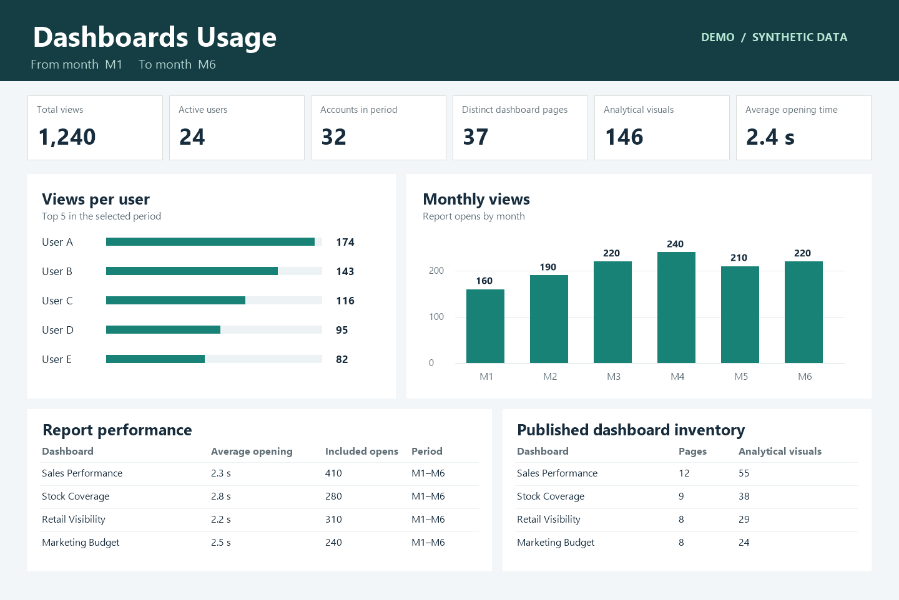

# BI Usage and Refresh

> **DEMO · SYNTHETIC DATA** — All figures, data labels, and example findings shown here are fictional and do not represent actual company results.

## Business question

Track dashboard adoption and keep report data current.

## My contribution

I built usage reporting and worked on gateway connections, scheduled refresh, and reconciling report values with source data.

## Decision supported

Use report views and activity trends to identify which reports need adoption follow-up. Use refresh checks and source reconciliation to investigate data issues.

## Full-page walkthrough

### Dashboard usage overview

The full page brings together activity KPIs, monthly views, usage by user, report opening times, and the published dashboard inventory. Teams can use it to see where adoption is growing and which reports warrant a closer look.

[Back to all projects](../../README.md)
