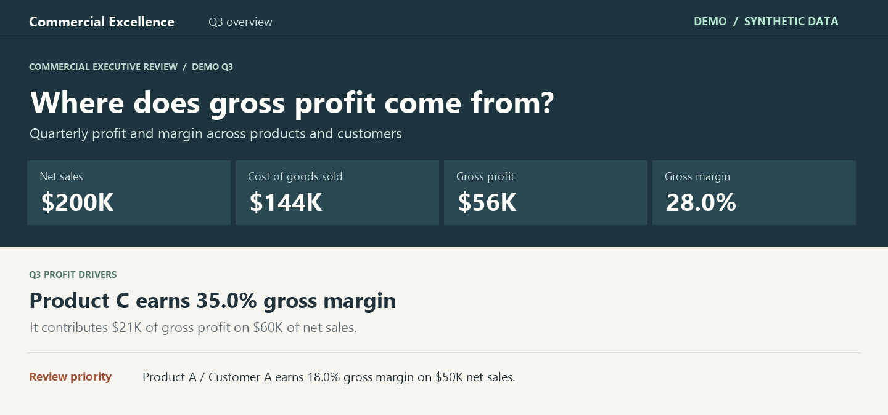
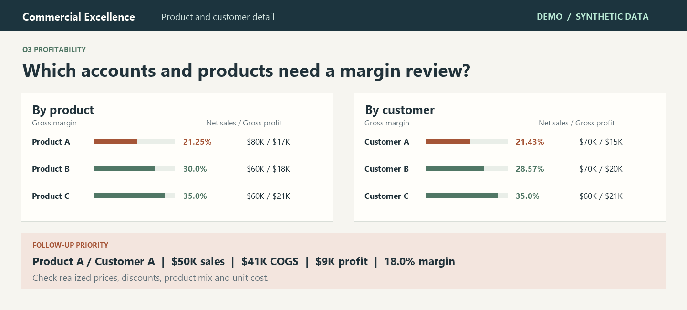
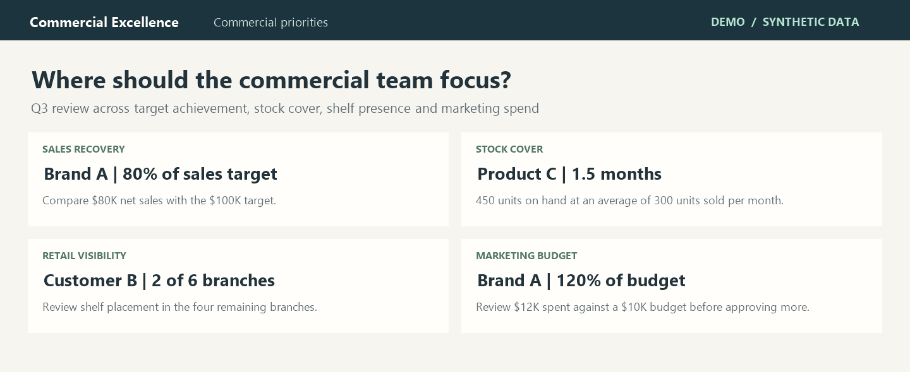
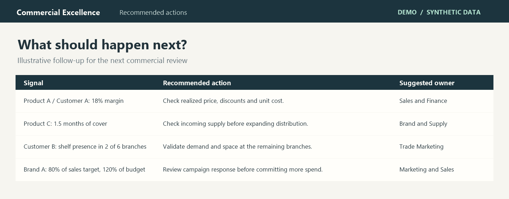

# Commercial Excellence and Profitability

> **DEMO · SYNTHETIC DATA** — All figures, data labels, and example findings shown here are fictional and do not represent actual company results.

## Business question

Find the products and customers that contribute profit and the combinations that need a margin review.

## My contribution

Commercial Excellence (ComEx) is a management review that brings sales, profitability, inventory, retail visibility, and marketing together to decide what the commercial team should act on. I developed executive reporting and analyzed net sales, cost of goods sold, gross profit, and margin by product and customer.

## Decision supported

Use the product and customer margin breakdowns to identify a follow-up, then assign an owner to validate the drivers.

## Full-page walkthrough

These visuals adapt the layout of the interactive Q3 ComEx report for a profitability case study. The overview summarizes the quarter and the detail shows where to investigate pricing, discounts, product mix, and costs.

### Q3 executive profitability overview

### Product and customer profitability

### Commercial priorities

The commercial review connects sales recovery, stock cover, shelf presence, and marketing spend. In this demo, Product C earns a 35% gross margin and has 1.5 months of cover. Review incoming supply before expanding distribution.

### Recommended Actions

I turned ComEx findings into recommended actions for the commercial review. Each recommendation states what the data shows, what the team should check or change, and who could follow up.

| Demo finding | Recommended action | Suggested owner |
| --- | --- | --- |
| Product A with Customer A contributes 25% of sales at an 18% gross margin, versus 28% overall. | Review realized prices, discounts, and unit costs before changing commercial terms. | Sales and Finance |
| Product C earns a 35% margin and contributes $21K gross profit. | Check incoming supply before expanding distribution. | Brand and Supply |
| Customer B has shelf presence in 2 of 6 branches. | Validate demand and space at the remaining branches. | Trade Marketing |
| Brand A is short of its sales target and has used 120% of its marketing budget. | Review campaign spend and sales response before committing additional budget. | Marketing and Sales |

[Back to all projects](../../README.md)
