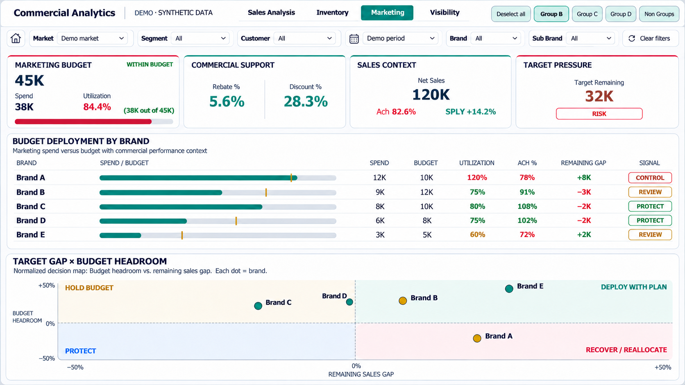

# Marketing Budget

> **DEMO · SYNTHETIC DATA** — All figures, data labels, and example findings shown here are fictional and do not represent actual company results.

## Business question

See where marketing spend is over plan and where to review the remaining budget.

## My contribution

I worked on a Power BI view that puts spend and budget next to sales target achievement and change versus the same period last year. I used a spend bar, a budget marker, and a status label so teams could spot cases for budget control, review, or continued support.

## Decision supported

Review spend together with target achievement to decide where to investigate budget efficiency before committing more.

## Full-page walkthrough

### Marketing Overview

This page puts the budget and sales KPIs, brand-level spend, and the budget decision map together. For example, Brand A is below its sales target and over budget, so the team can review spending before committing more.

[Back to all projects](../../README.md)
