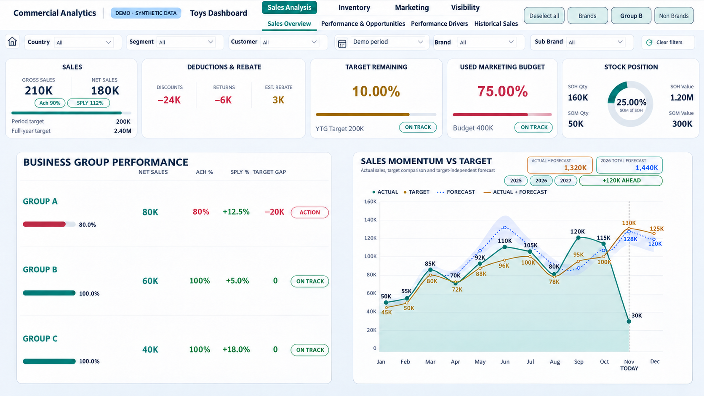
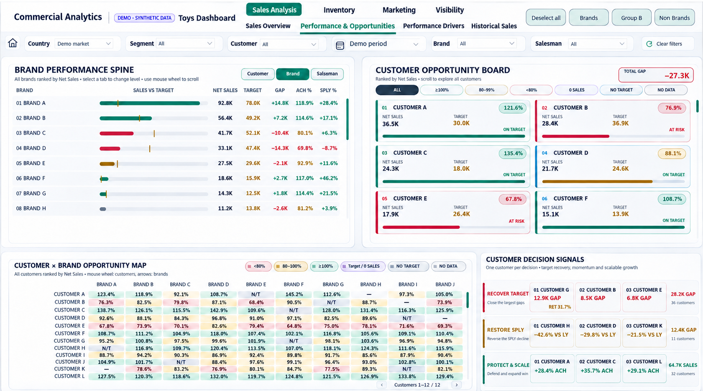

# Sales Performance

> **DEMO · SYNTHETIC DATA** — All figures, data labels, and example findings shown here are fictional and do not represent actual company results.

## Business question

Compare actual sales with plan and find the customers or brands driving the gap.

## My contribution

I connected ERP and Excel inputs, shaped the data in Power Query, and built DAX measures for net sales, target achievement, and prior-year comparison. I designed the overview and drill-down so a manager could start at the business group level, then see which brands and customers needed follow-up.

## Decision supported

Start with the sales-to-target gap, then use the brand ranking and customer-by-brand matrix to decide where to investigate.

## Full-page walkthrough

### Sales Overview

### Performance and Opportunities

The ranking, customer cards, and customer-by-brand matrix show where to investigate a shortfall or protect growth.

[Back to all projects](../../README.md)
