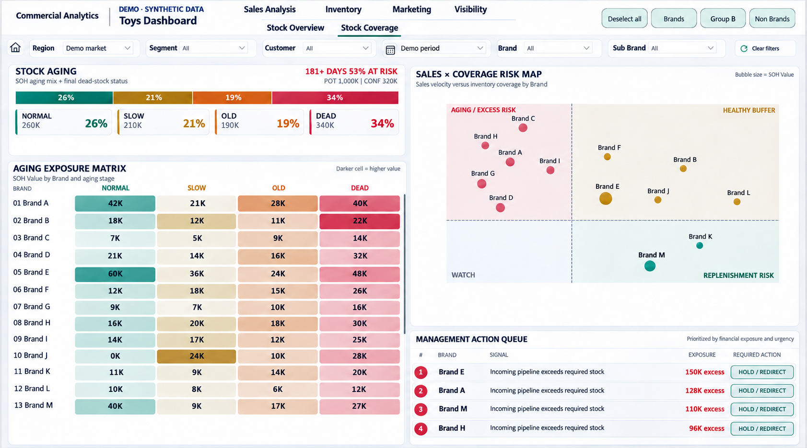
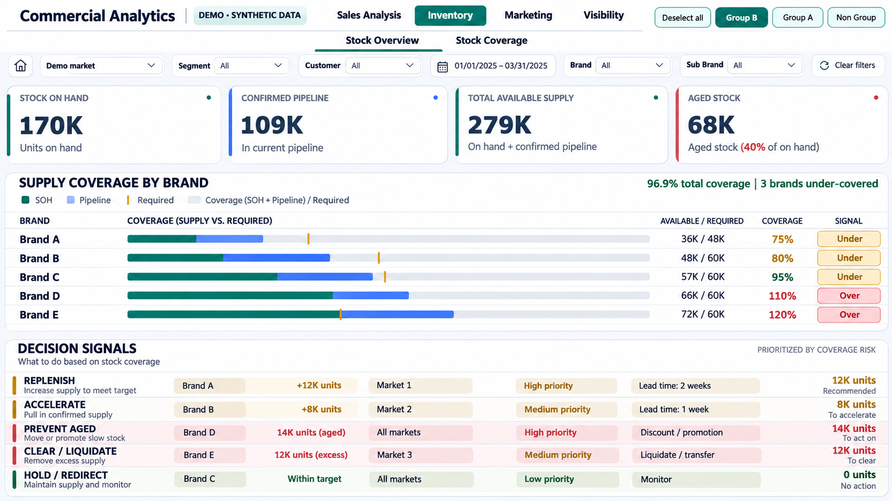

# Stock Coverage and Aging

> **DEMO · SYNTHETIC DATA** — All figures, data labels, and example findings shown here are fictional and do not represent actual company results.

## Business question

Identify stock that is aging or at risk of running short.

## My contribution

I built inventory views that connect stock on hand, aging, sales pace, and incoming orders. The aging matrix shows where stock value is concentrated, while the risk map and action queue help teams decide which brands to review for excess stock or replenishment.

## Decision supported

Compare stock aging, sales pace, and incoming orders before deciding which brands need replenishment or excess-stock follow-up.

## Full-page walkthrough

### Stock Overview

The full overview connects the stock and pipeline KPIs to supply coverage by brand and the Decision Signals panel. It shows which brands need replenishment and which have excess supply.

[Back to all projects](../../README.md)
