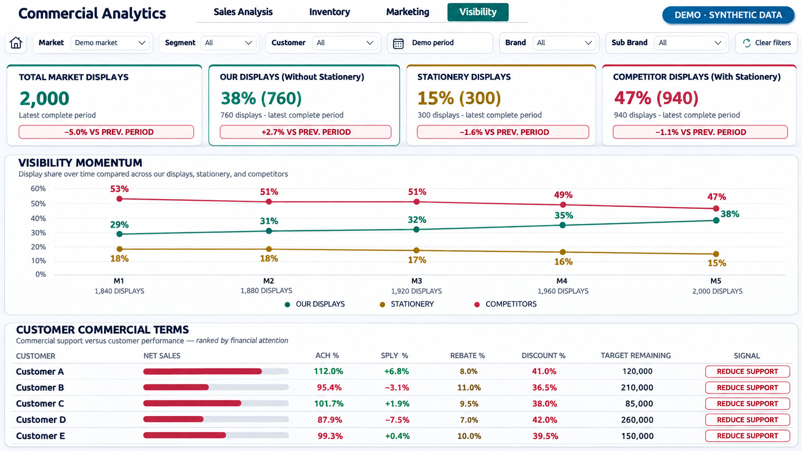
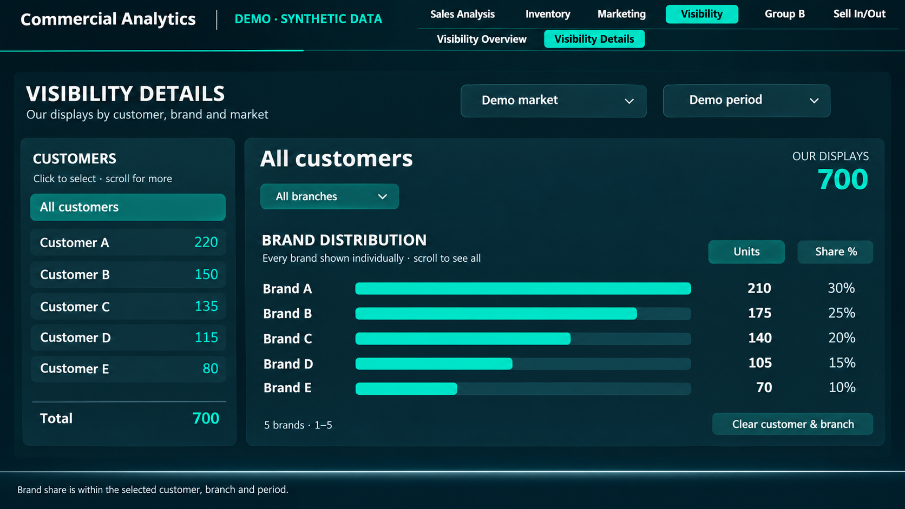

# Retail Visibility

> **DEMO · SYNTHETIC DATA** — All figures, data labels, and example findings shown here are fictional and do not represent actual company results.

## Business question

See how shelf displays are distributed by retailer, branch, and brand.

## My contribution

I added a detail view so brand managers could select a customer, narrow to a branch, and compare each brand’s display count and share within that selection. This helps teams see where a brand has a strong presence and where they may need to review shelf allocation.

## Decision supported

Use the trend to identify a change in display share, then narrow to a customer and branch before reviewing shelf allocation.

## Full-page walkthrough

### Visibility Overview

The full overview brings together retail-space KPIs, the visibility trend, and customer commercial terms. The detail page lets teams investigate individual customers, branches, and brands.

### Visibility Details

[Back to all projects](../../README.md)
